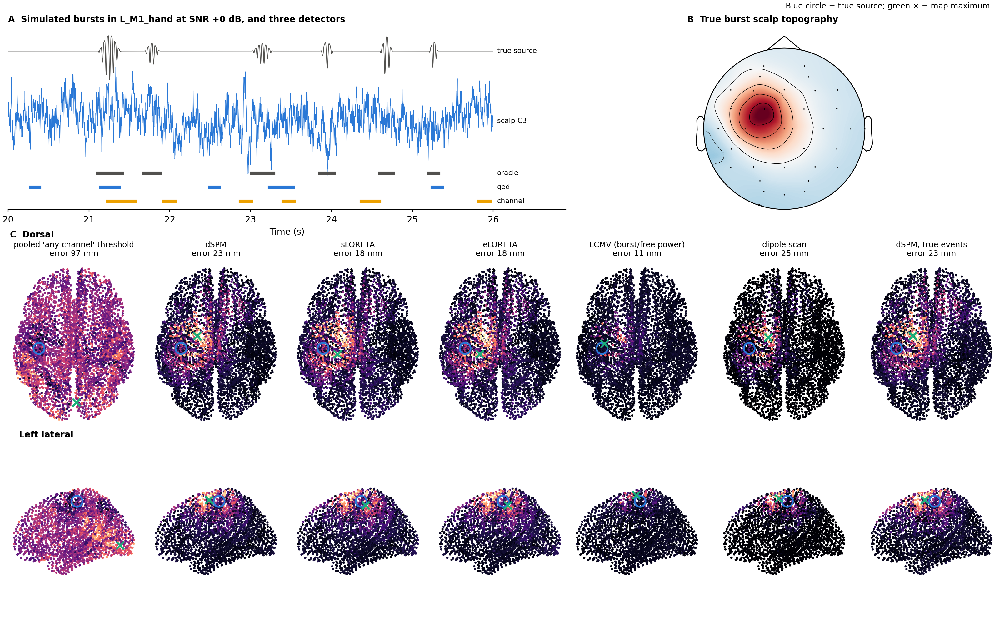
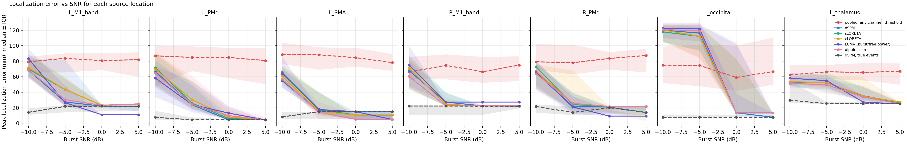
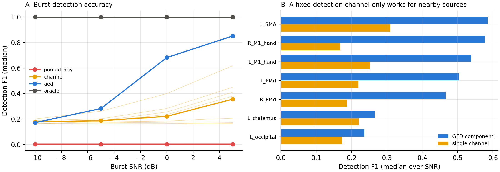
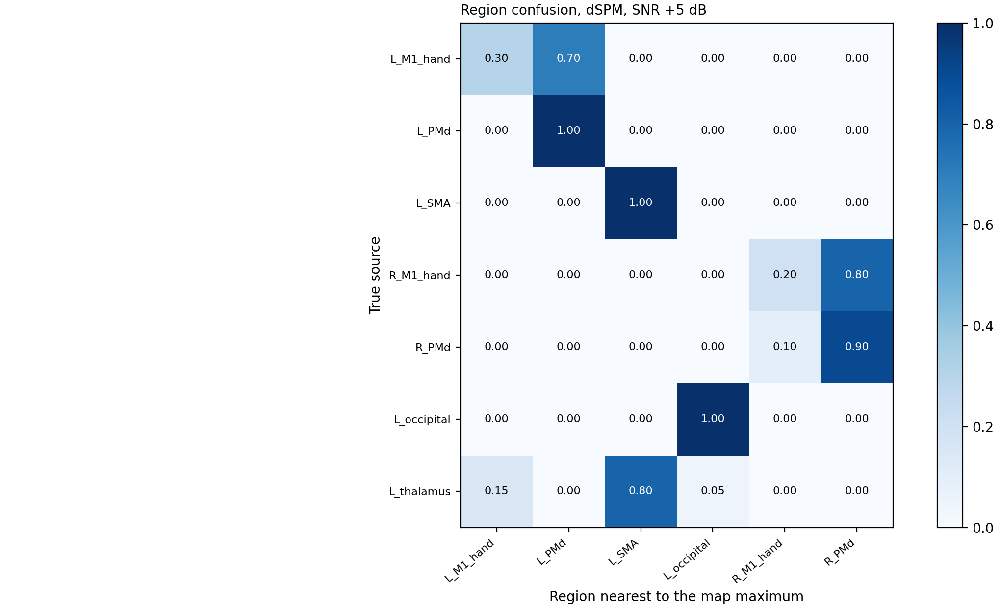
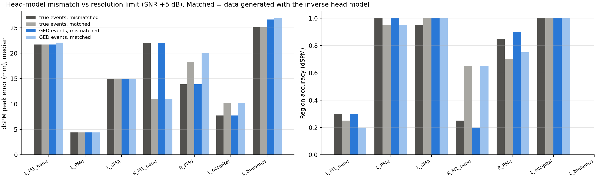
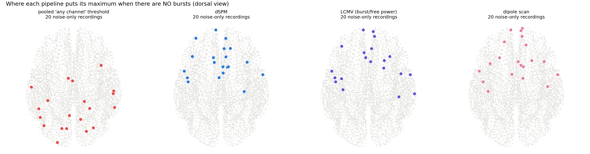
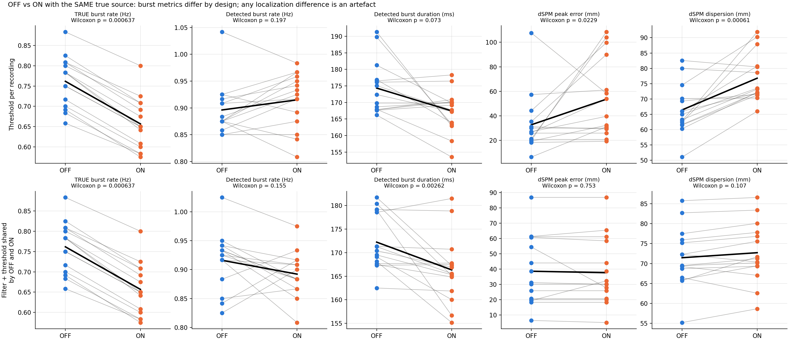

# Ground-truth simulation of EEG beta-burst source localization

A simulation framework that tests whether transient beta bursts can be **detected and localized** from
32-channel scalp EEG with a template head model. Bursts are placed at known cortical and deep locations,
projected to the scalp through a realistic head model, buried in realistic background activity, then
detected and localized by several standard pipelines. Every map is scored against the ground truth.

The question is practical: **before a burst source map from real EEG is interpreted, how accurate can that
map be?**

In this setup, the answer is: **correct pipelines are about 1–2 cm accurate at good SNR, but cannot reliably tell
M1 from the premotor cortex, a deep source always appears on the cortex, and a common shortcut (one
threshold pooled across all channels) does not localize at all.**



> **Scope.** One template head (fsaverage), one montage (BioSemi 32), simulated bursts. The framework shows
> what such a pipeline can and cannot resolve; it does not validate any particular real-data map. All
> numbers below come from the reference run (20 seeds per cell, 120 s recordings).

---

## Contents

| File | What it is |
|---|---|
| `beta_burst_sim.ipynb` | The full framework: simulation, detection, localization, scoring, experiments, figures |
| `requirements.txt` | Python dependencies |
| `figures/` | Figures from the reference run |
| `results/` | Per-recording result tables (CSV) from the reference run |
| `LICENSE` | MIT |

## Quick start

```bash
git clone https://github.com/tanvir-hasib/<repo-name>.git
cd <repo-name>
pip install -r requirements.txt
jupyter notebook beta_burst_sim.ipynb      # then Run All
```

The first run downloads the fsaverage template (about 200 MB, via `mne.datasets.fetch_fsaverage`) and
builds two 3-layer BEMs. Run time for the reference run is about 40 min on a desktop CPU.

| Switch (top of notebook) | Default | Effect |
|---|---|---|
| `HEAD_MODEL` | `"fsaverage"` | `"offline"` uses a no-download approximation (fsaverage5 cortex from nilearn, MNE's bundled inner skull). Use it only for testing. |
| `QUICK_MODE` | `False` | `True` gives a ~5 min smoke test (3 seeds, 2 SNRs, 60 s recordings) |
| `BURST_MODEL` | `"event"` | `"jr"` generates bursts from a noise-driven Jansen–Rit column instead of windowed oscillations |
| `REAL_BACKGROUND_FILE` | `None` | A resting EEG file to use as background instead of simulated activity |
| `CFG["run_matched_control"]` | `True` | Run the matched-head-model control (section 7) |

All parameters live in the `CFG` dictionary. Seeds are fixed, so a run reproduces the reference numbers.

## How the simulation works

```
burst generator ─► source patch (10 mm) ─► generating head model ─► + background ─► scalp EEG (avg ref)
                                                                                      │
          scores ◄─ map vs truth ◄─ inverse (inverse head model) ◄─ trough-aligned events ◄─ detection
```

| Stage | Implementation |
|---|---|
| **Bursts** | Hann-windowed 16–24 Hz events with log-normal duration and amplitude, sharpened troughs (non-sinusoidal beta). Optional Jansen–Rit column driven across its Hopf point. Ground truth: onset, offset and deepest trough of every burst. |
| **Sources** | Seven locations (fsaverage ≈ MNI): left and right M1 hand area, left and right dorsal premotor (PMd), left SMA, a left occipital control, and a deep left thalamic dipole. Cortical sources are 10 mm patches with fixed normal orientation. |
| **Head models** | fsaverage, 3-layer BEM, BioSemi 32. Data are **generated** with skull conductivity 0.0042 S/m, ico5 sources (20 484) and electrodes jittered by 5 mm, and **inverted** with 0.006 S/m, ico4 sources (5 124) and template electrodes. This avoids the "inverse crime". |
| **Background** | 300 random cortical sources with 1/f activity, posterior alpha, weak ongoing beta, white sensor noise. SNR = burst RMS ÷ background beta-band RMS at the strongest channel. |
| **Detection** | One beta envelope, 75th-percentile threshold, ≥ 2 cycles, gaps < 50 ms merged, one event per burst at its deepest trough. |
| **Localization** | Noise covariance from burst-free data, `nave` = number of bursts, depth weighting 0.8. Maps from trough-aligned averages (±25 ms RMS), except LCMV, which uses beta-band power in bursts ÷ burst-free power. |

### Pipelines compared

| Detector | Detection signal |
|---|---|
| `pooled_any` | One percentile pooled over all channels; a sample counts if **any** channel exceeds it. Every flagged sample is a trigger. Included as a negative control. |
| `channel` | One fixed channel (C3) |
| `ged` | Leading generalized-eigendecomposition component, beta band vs broadband |
| `oracle` | The true burst troughs (upper bound) |

Localization methods: **dSPM**, **sLORETA**, **eLORETA**, **LCMV** beamformer, **single-dipole scan**,
each implemented directly on the gain matrix (whitened, average-reference null space removed).

### Scores

| Score | Definition |
|---|---|
| Peak error | Distance (mm) from the map maximum to the true source centroid |
| Spatial dispersion | √(Σ m²d² / Σ m²); for LCMV the weights are max(ratio − 1, 0)² |
| AUC | Vertices inside the true patch vs all others |
| Region accuracy | Map maximum closer to the true region than to any other region |
| Hemisphere accuracy | Map maximum in the true hemisphere |
| Detection F1 | Detected vs true troughs matched within ±100 ms |

## Results (reference run)

### 1. The pooled "any channel" threshold does not localize

The pooled rule flags **93 %** of all samples as burst. Its maps peak **77–79 mm** from the source and pick
the right region in **13–18 %** of recordings (about chance among six cortical regions) at every SNR. Its
error does not improve when the bursts get stronger.

### 2. With a correct pipeline, detection limits accuracy

| SNR | GED F1 | dSPM, GED events: error / region acc. | dSPM, true events: error / region acc. | LCMV, GED events: error / region acc. |
|---|---|---|---|---|
| −10 dB | 0.17 | 66 mm / 13 % | 15 mm / 78 % | 71 mm / 15 % |
| −5 dB | 0.28 | 35 mm / 33 % | 14 mm / 76 % | 27 mm / 33 % |
| 0 dB | 0.68 | 21 mm / 67 % | 15 mm / 74 % | 15 mm / 67 % |
| +5 dB | 0.85 | 15 mm / 73 % | 15 mm / 73 % | **11 mm / 84 %** |

Median peak error, pooled over all seven locations. With the true burst times, the error barely changes
with SNR. At −10 and −5 dB, almost all of the error comes from detection. A single fixed channel (C3)
never exceeds F1 = 0.36.




### 3. M1 and PMd cannot be separated reliably

At +5 dB, with dSPM:

| True source | Peak error | Region accuracy (GED events) | Region accuracy (true events) |
|---|---|---|---|
| L M1 hand | 21.7 mm | **30 %** (70 % → L PMd) | 30 % |
| R M1 hand | 22.0 mm | **20 %** (80 % → R PMd) | 25 % |
| L PMd | 4.4 mm | 100 % | 100 % |
| R PMd | 13.9 mm | 90 % | 85 % |
| L SMA | 14.9 mm | 100 % | 95 % |
| L occipital | 7.8 mm | 100 % | 100 % |

The M1 and PMd centroids are 23 mm (left) and 19 mm (right) apart. The M1 error is a **systematic bias,
not noise**: it does not shrink with SNR or with perfect detection, and the maximum repeatedly lands on the
same few vertices anterior to the source, on the premotor side. Repeated values in the tables (such as
14.92 or 21.55 mm) reflect this: the maximum falls on the same inverse-grid vertex across seeds.



### 4. The M1 bias is not caused by head-model mismatch (on the left)

The control generates data with the inverse head model itself (same conductivities, template electrodes;
only the source-space density differs). Median peak error over 0 and +5 dB:

| Source | dSPM, true events: mismatched | matched | LCMV: mismatched | matched |
|---|---|---|---|---|
| L M1 hand | 22.1 mm | 21.7 mm | 10.9 mm | 10.9 mm |
| R M1 hand | 22.0 mm | 11.0 mm | 27.3 mm | 26.5 mm |
| L PMd | 4.4 mm | 4.4 mm | 4.4 mm | 17.1 mm |
| R PMd | 16.6 mm | 17.9 mm | 9.2 mm | 17.2 mm |

For left M1, a perfect head model gives the same 22 mm error: the bias comes from 32-channel resolution,
the folding of the central sulcus, and the minimum-norm depth weighting, not from the head model. Right M1
is more sensitive to the mismatch, and LCMV is accurate for left M1 but not right M1. The head-model effect
is not consistent in direction either: LCMV is *less* accurate for PMd with the matched model (4 → 17 mm on
the left), so the location of the maximum is sensitive to small changes in the forward model. **No method is
reliably accurate for M1**, and results depend on the exact local folding.



### 5. A deep source always appears on the cortex

A thalamic source (MNI −12, −18, 8) is mislocalized by 25–28 mm with every method and assigned to **SMA in
80 %** and to M1 in 15 % of recordings. A "motor cortex" peak in EEG does not rule out a deep generator.

### 6. Noise-only recordings still produce a peak

With no bursts at all, every pipeline still produces a maximum. dSPM and the dipole scan place it mostly in
frontal and central midline cortex, overlapping the motor regions of interest. Maps need statistics against
a null (e.g., permutation of burst/non-burst labels), not just a peak location.



### 7. OFF vs ON: differences from the same source

Fifteen simulated patients each have a fixed left-M1 source (jittered by 6 mm between patients). OFF and
ON differ only in burst rate, duration and amplitude, at −5 dB. Every pair is analysed twice: with a
threshold set per recording, and with one GED filter and threshold shared by OFF and ON.

| Same true source in both conditions | Threshold per recording | Shared threshold |
|---|---|---|
| True burst rate, OFF vs ON | 0.76 vs 0.66 /s (p = 0.0006) | same |
| Detected burst rate | 0.90 vs 0.92 /s (p = 0.20) | 0.92 vs 0.89 /s (p = 0.16) |
| dSPM peak error, OFF − ON | **−20.9 mm (p = 0.023)** | 1.0 mm (p = 0.75) |
| dSPM dispersion, OFF − ON | **−10.3 mm (p = 0.0006)** | −1.3 mm (p = 0.11) |
| dSPM dispersion with true events, OFF − ON | −3.7 mm (p = 0.002) | same |

Wilcoxon signed-rank tests, n = 15.

- With a per-recording threshold, a **"significant" localization difference appears with no change in
  location**. A shared threshold removes most of it.
- **Even the shared threshold does not recover the true rate difference.** At −5 dB about 70 % of detected
  events are background beta, so the detected burst rate mostly reflects noise.
- **Dispersion still differs with perfect detection**, because weaker ON bursts give broader maps. Map
  spread can only be compared between conditions if burst SNR and the number of bursts averaged are matched.



## Practical recommendations for real data

1. Detect bursts on **one** spatial signal (a GED component or a source time course), never as "any channel
   above a pooled threshold".
2. Align events to the burst trough, set `nave` to the number of bursts, and estimate the noise covariance
   from burst-free data.
3. For condition comparisons, use one filter and threshold per subject shared across conditions, and match
   the number of bursts and burst amplitude before comparing map dispersion.
4. With 32 channels and a template head, report results at the level of the sensorimotor region, not M1 vs
   premotor cortex, and do not rule out deep sources.
5. Test maps against a noise-only or label-permuted null.
6. Run this framework with your own montage, SNR and burst statistics before interpreting a real map.

## Limitations

- **One template head.** Individual anatomy, a denser montage or MEG would change the numbers, especially
  for M1 vs PMd.
- **Simulated bursts and background.** Real bursts vary in waveform, spatial extent and orientation; real
  background contains real bursts. `REAL_BACKGROUND_FILE` allows a real background, but then its ground
  truth is impure.
- **Single-source recordings.** Each recording has one burst source; simultaneous bilateral or
  cortico-subcortical bursts are not simulated.
- **Location-dependent results.** Errors differ between hemispheres and between neighbouring locations
  because of local folding, so the tables describe these seeds, not the motor cortex in general.
- **Coarse region score.** Region accuracy assigns the maximum to the nearest of six seeds; it measures
  separability among these regions only.

## Reproducing the figures

The notebook writes all figures and tables to `burst_sim_results/`. The files in `figures/` and `results/`
are copies from the reference run.

| Figure | Notebook output |
|---|---|
| Example recording and maps | `fig1_example.png` |
| Error vs SNR per location | `fig2_error_vs_snr.png` |
| Region confusion (dSPM, LCMV) | `fig3_confusion_dSPM.png`, `fig3b_confusion_LCMV.png` |
| Detection accuracy | `fig4_detection.png` |
| Noise-only maxima | `fig5_noise_only.png` |
| OFF vs ON | `fig6_group_offon.png` |
| Matched-head-model control | `fig7_matched_control.png` |

## Citation

If you use this code, please cite this repository:

```bibtex
@software{hasib_beta_burst_sim_2026,
  author = {Hasib, Tanvir},
  title  = {Ground-truth simulation of {EEG} beta-burst source localization},
  year   = {2026},
  url    = {https://github.com/tanvir-hasib/<repo-name>}
}
```

Key method references: Dale et al. (2000), *Neuron* 26:55–67 (dSPM) · Pascual-Marqui (2002), *Methods Find.
Exp. Clin. Pharmacol.* 24D:5–12 (sLORETA) · Pascual-Marqui (2007), arXiv:0710.3341 (eLORETA) · Van Veen et
al. (1997), *IEEE Trans. Biomed. Eng.* 44:867–880 (LCMV) · Gramfort et al. (2013), *Front. Neurosci.* 7:267
(MNE-Python) · Cohen (2022), *NeuroImage* 247:118809 (GED) · Shin et al. (2017), *eLife* 6:e29086 (beta
events).

## License

MIT — see [`LICENSE`](LICENSE).

## Contact

Tanvir Hasib · Multimedia University, Malaysia · open an [issue](../../issues) for questions or bug reports.
